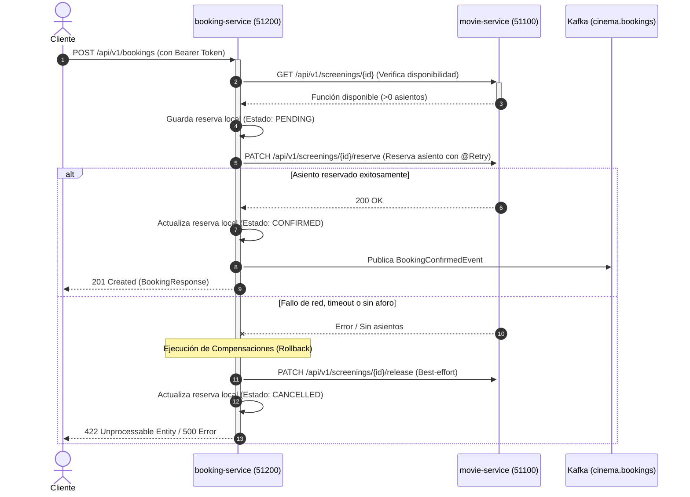

# 🎬 Sistema de Reserva de Cine - Microservicios & SAGA

Este proyecto implementa un sistema distribuido de reserva de entradas de cine aplicando **Domain-Driven Design (DDD)**, **Arquitectura Hexagonal (Ports & Adapters)** y el **Patrón SAGA Orquestado** para garantizar la consistencia eventual y la compensación automática de transacciones entre microservicios.

---

## 🛠️ Tecnologías Principales

- **Lenguaje & Framework:** Java 25 & Spring Boot 4.0.3
- **Gestión de Dependencias:** Apache Maven 3.9+
- **Arquitectura:** Hexagonal (Puertos y Adaptadores) & Domain-Driven Design (DDD)
- **Seguridad:** OAuth2 Resource Servers con JWT firmado en RSA (RS256) y validación de claves públicas vía JWKS
- **Resiliencia:** Resilience4j (`@Retry` con retroceso exponencial / exponential backoff)
- **Persistencia:** PostgreSQL 16 con versionamiento y migraciones mediante Flyway
- **Mensajería Asíncrona:** Apache Kafka 7.7 (Event-Driven en modo KRaft)
- **Documentación de APIs:** OpenAPI 3.0 / Swagger UI (SpringDoc)
- **Observabilidad:** Spring Boot Actuator

---

## 🏗️ Topología y Puertos

| Microservicio | Puerto Host | Context Path | Base de Datos | Rol en la Arquitectura |
| :--- | :---: | :---: | :---: | :--- |
| `auth-service` | **50003** | `/` | (En memoria) | Proveedor de autenticación, emisor de JWT (RS256) y endpoint JWKS. |
| `movie-service` | **51100** | `/api/v1` | `moviedb` | Catálogo de películas, salas, funciones y control de aforo/asientos. |
| `booking-service` | **51200** | `/api/v1` | `bookingdb` | Orquestador del SAGA de reservas y publicador de eventos a Kafka. |
| **PostgreSQL** | **5432** | - | `moviedb`, `bookingdb` | Motor de base de datos relacional para ambos microservicios. |
| **Apache Kafka** | **29092** | - | - | Broker de mensajería (Topic: `cinema.bookings`). |

---

## 🔄 Flujo del Patrón SAGA

El microservicio `booking-service` actúa como el **Orquestador** del ciclo de vida de la reserva:



### SAGA Inverso (Cancelación Explícita)
Al invocar `PATCH /api/v1/bookings/{id}/cancel`:
1. `booking-service` valida el estado y marca la reserva como `CANCELLED`.
2. Se ejecuta la compensación remota llamando a `PATCH /api/v1/screenings/{id}/release` en `movie-service` para liberar el asiento.

---

## 📋 Requisitos Previos

- **JDK 25** instalado y configurado en la variable de entorno `JAVA_HOME`.
- **Apache Maven 3.9+** instalado.
- **Docker** y **Docker Compose** en ejecución.
- Cliente HTTP (`curl`, Postman o HTTPie).

---

## 🚀 Instrucciones de Arranque

Sigue estos pasos en orden para compilar e iniciar la infraestructura y los microservicios sin errores de dependencia:

### 1. Levantar Infraestructura (PostgreSQL y Kafka)

Asegúrate de tener un contenedor PostgreSQL escuchando en el puerto `5432` con las bases de datos `moviedb` y `bookingdb`, y Kafka en el puerto `29092`:

```bash
docker compose up -d
```

> **Nota sobre bases de datos:** Si utilizas una instancia limpia de PostgreSQL, asegúrate de crear ambas bases de datos antes de iniciar los servicios:
> ```sql
> CREATE DATABASE moviedb;
> CREATE DATABASE bookingdb;
> ```

---

### 2. Compilar los Microservicios

Cada microservicio se gestiona con su propio `pom.xml`:

```bash
# Compilar auth-service
mvn -f auth-service/pom.xml clean package -DskipTests

# Compilar movie-service
mvn -f movie-service/pom.xml clean package -DskipTests

# Compilar booking-service
mvn -f booking-service/pom.xml clean package -DskipTests
```

---

### 3. Iniciar los Servicios en Orden

> **IMPORTANTE:** `auth-service` debe iniciarse **primero** para que el endpoint de claves públicas JWKS (`/oauth2/jwks`) esté disponible cuando `movie-service` y `booking-service` validen tokens.

Ejecuta cada servicio en una terminal independiente:

#### Terminal 1 — auth-service (Puerto 50003)
```bash
cd auth-service
mvn spring-boot:run
```

#### Terminal 2 — movie-service (Puerto 51100)
```bash
cd movie-service
mvn spring-boot:run
```
*(Flyway creará automáticamente las tablas e insertará los datos de prueba iniciales).*

#### Terminal 3 — booking-service (Puerto 51200)
```bash
cd booking-service
mvn spring-boot:run
```

---

## 🔐 Seguridad y Autenticación

Todos los endpoints de negocio en `movie-service` y `booking-service` actúan como **OAuth2 Resource Servers** y requieren un token Bearer JWT válido.

### Credenciales en Memoria (auth-service)
| Usuario | Contraseña | Rol Asignado |
| :--- | :--- | :--- |
| `admin` | `admin123` | `ROLE_ADMIN` |
| `user` | `user123` | `ROLE_USER` |

### Propagación Automática de Token
`booking-service` incorpora un interceptor HTTP (`JwtPropagationInterceptor`). Cuando un cliente invoca el endpoint de reservas enviando su JWT en la cabecera `Authorization`, el servicio extrae el token del contexto de seguridad y lo propaga automáticamente en las llamadas HTTP internas hacia `movie-service`.

---

## 🧪 Guía de Pruebas End-to-End (E2E)

### Datos Semilla Precargados (Flyway)
- **Película:** `11111111-1111-1111-1111-111111111111` (*Dune*)
- **Función (Screening):** `33333333-3333-3333-3333-333333333333` (*Sala IMAX - 45 asientos disponibles*)

---

### Paso 1: Autenticarse y Obtener Token JWT

```bash
curl -s -X POST http://localhost:50003/api/v1/auth/login \
  -H "Content-Type: application/json" \
  -d "{\"username\": \"admin\", \"password\": \"admin123\"}"
```

Copia el `accessToken` devuelto y expórtalo en tu terminal:
```bash
# En Bash / macOS / Linux:
export TOKEN="tu_access_token_aqui"

# En Windows PowerShell:
$TOKEN = "tu_access_token_aqui"
```

---

### Paso 2: Consultar Función en movie-service

Verifica la disponibilidad inicial de la sala IMAX (45 asientos):

```bash
curl -s -X GET http://localhost:51100/api/v1/screenings/33333333-3333-3333-3333-333333333333 \
  -H "Authorization: Bearer $TOKEN"
```

---

### Paso 3: Crear Reserva (Ejecución del SAGA)

Ejecuta el SAGA orquestado creando una reserva:

```bash
curl -s -X POST http://localhost:51200/api/v1/bookings \
  -H "Authorization: Bearer $TOKEN" \
  -H "Content-Type: application/json" \
  -d "{
    \"screeningId\": \"33333333-3333-3333-3333-333333333333\",
    \"customerId\": \"aaaaaaaa-aaaa-aaaa-aaaa-aaaaaaaaaaaa\",
    \"totalAmount\": 35.00
  }"
```

**Resultado:**
- Retorna código HTTP `201 Created` con el JSON de la reserva en estado `CONFIRMED`.
- Se descuenta 1 asiento en `movie-service` (el aforo disponible ahora es 44).
- Se publica el evento `BookingConfirmedEvent` en el topic de Kafka `cinema.bookings`.

---

### Paso 4: Cancelar Reserva (SAGA Inverso y Compensación)

Sustituye `<BOOKING_ID>` por el ID obtenido en el paso anterior:

```bash
curl -s -X PATCH http://localhost:51200/api/v1/bookings/<BOOKING_ID>/cancel \
  -H "Authorization: Bearer $TOKEN"
```

**Resultado:**
- La reserva pasa a estado `CANCELLED`.
- Se invoca la compensación remota que restituye el asiento en `movie-service` (vuelve a 45).

---

## 📖 Documentación Swagger UI & Endpoints Clave

| Recurso | URL |
| :--- | :--- |
| **Swagger UI — movie-service** | [http://localhost:51100/api/v1/swagger-ui.html](http://localhost:51100/api/v1/swagger-ui.html) |
| **OpenAPI Docs — movie-service** | [http://localhost:51100/api/v1/v3/api-docs](http://localhost:51100/api/v1/v3/api-docs) |
| **Swagger UI — booking-service** | [http://localhost:51200/api/v1/swagger-ui.html](http://localhost:51200/api/v1/swagger-ui.html) |
| **OpenAPI Docs — booking-service** | [http://localhost:51200/api/v1/v3/api-docs](http://localhost:51200/api/v1/v3/api-docs) |
| **JWKS Endpoint (Auth Service)** | [http://localhost:50003/oauth2/jwks](http://localhost:50003/oauth2/jwks) |
| **Health Check — auth-service** | [http://localhost:50003/actuator/health](http://localhost:50003/actuator/health) |
| **Health Check — movie-service** | [http://localhost:51100/api/v1/actuator/health](http://localhost:51100/api/v1/actuator/health) |
| **Health Check — booking-service** | [http://localhost:51200/api/v1/actuator/health](http://localhost:51200/api/v1/actuator/health) |

---

## 🛡️ Resiliencia y Manejo de Errores

`booking-service` incorpora **Resilience4j** en el cliente `MovieServiceClient`:
- **Instancia configurada:** `movieServiceRetry`
- **Reintentos máximos:** 3 intentos con retroceso exponencial (`waitDuration: 500ms`, `multiplier: 2`).
- **Filtro de excepciones:** Se reintenta únicamente ante errores de servidor (`5xx`) o fallos de red (`ResourceAccessException`). Las excepciones de negocio (como `NoSeatsAvailableException` / `422`) se descartan para no realizar reintentos innecesarios.